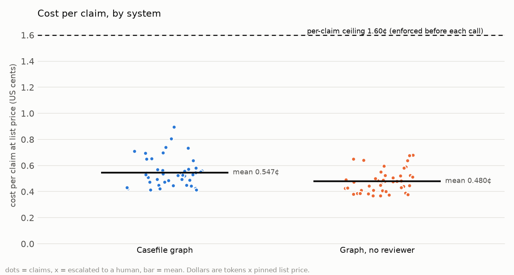
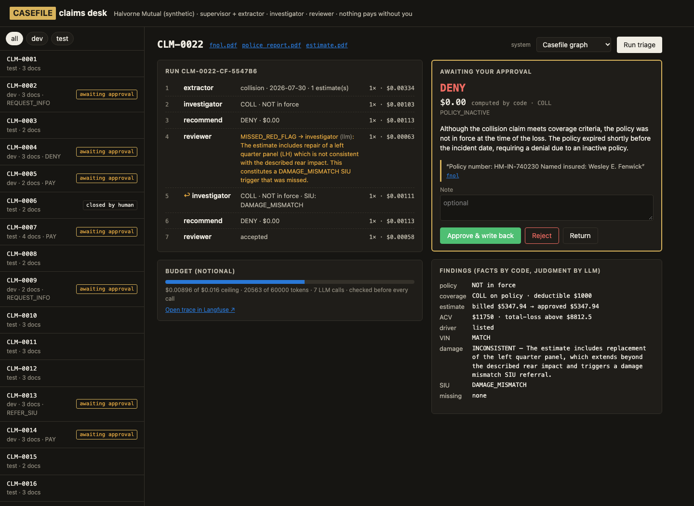
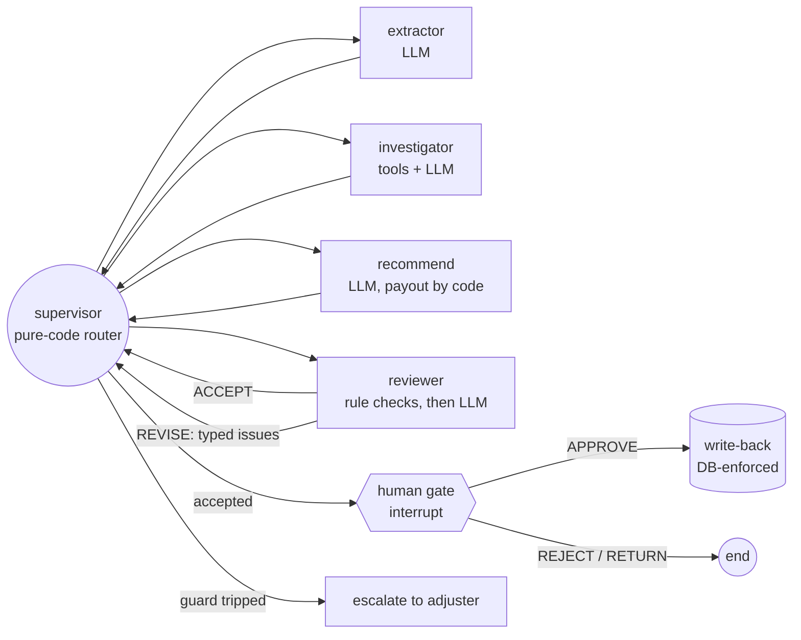

# Casefile

**Multi-agent claims triage for a regional auto insurer: bounded, observable, replayable, and unable to pay a claim without a human.**

Project page: [omkar-ku1karni.github.io/casefile](https://omkar-ku1karni.github.io/casefile/)

A supervisor and three specialists (extractor, investigator, reviewer) read a claim's PDFs, check the policy, prior claims and repair prices, and draft a recommendation. An adjuster approves it before anything is written back. Termination guards, the per-claim cost ceiling and the approval lock are all enforced in code, and tests cover them.


<!-- RESULTS:START -->
## Results

Final development run: 45 claims, 3 per scenario, all 15 scenarios. The no-reviewer column is derived from the
same runs' checkpoints, so the comparison is paired.

| | Casefile graph | Graph without reviewer |
|---|---|---|
| Decisions correct | **100%** (45/45) | 95.6% (43/45) |
| Unsafe approvals (recommends paying a claim it shouldn't) | **0** | 2 |
| Exact payout, SIU-flag recall, extraction accuracy | 100%, 100%, 100% | 100%, 100%, 100% |
| LLM calls per claim | 4.2 | 3.0 |
| Cost per claim at list price (mean / max) | $0.0055 / $0.0090 | $0.0048 / $0.0068 |
| Cost-ceiling overruns | 0 | 0 |

- The reviewer caught both unsafe approvals: two claims missing a required document, where the makers recommended
  PAY instead of REQUEST_INFO. Its 4 send-backs all terminated.
- On 22 held-out test claims, the graph made no errors.
- The most expensive claim used 56% of the $0.016 ceiling.



Full tables, per-scenario accuracy and the first development run are in [RESULTS.md](RESULTS.md).
`make report BATCH=<batch>` regenerates them from the run database.
<!-- RESULTS:END -->

---

## The problem

A regional auto insurer receives 900 claims a day. Each one needs four things:

- the documents extracted
- prior claims and policy limits checked
- the damage estimate sanity-checked against repair costs
- a recommendation written

That's too much for one prompt, so the work is split across four agents. The catch is that the system has to stop when it should, and it must never pay out without a human signing off.

The failure I wanted to design out is the familiar one: agents passing work around in a circle with nothing to stop them. That looks fine in a demo and then the bill arrives.

## What it looks like



*The adjuster desk (`make serve`) shows:*
- *the node-by-node timeline, with reviewer send-backs*
- *a budget meter against the per-claim ceiling*
- *facts computed by code next to the LLM's judgments*
- *the approval gate*

## How it works



My rule of thumb here: the LLM does the reading and judging, and code does anything that has to be exact.

| Step | LLM | Code |
|---|---|---|
| Extractor | reads 2–4 messy PDFs (3 shop layouts, mixed date formats, typos) into a typed `ExtractedClaim` | validates the schema; one repair round trip |
| Investigator | judges coverage from the cause of loss (e.g. *swerved to miss a deer* is collision), whether the driver is listed, a VIN typo vs a different car, and whether the damage matches the story | calls the claims-system tools (policy, valuation, prior claims, price check); computes policy-in-force, missing documents, date conflicts, prior-damage overlap, approved repair cost, total loss |
| Supervisor | drafts the recommendation and rationale for the adjuster | routes (pure function), computes the payout in integer cents |
| Reviewer | second opinion on the judgment calls (a different model family from the makers) | first checks:<br>• estimate totals re-add to the printed total<br>• every document was extracted<br>• every part number is in the catalog<br>• every citation is a verbatim quote<br>• the decision matches the claims-manual rules applied to the findings |

### Bounded

- Router as a pure function. [`router.decide_next(state)`](src/casefile/router.py) checks the guards first on every hop: budget, `max_steps=14`, `max_revisions=2`, and the same complaint repeated. A [Hypothesis property test](tests/test_termination.py) drives it with 3,000 random sequences of agent outputs, including a reviewer that never accepts. It must reach a terminal state within the step limit every time.
- LangGraph's `recursion_limit` is only a backstop. It is set above anything the router allows.
- Typed handoffs only. Every node reads and writes Pydantic models ([`contracts.py`](src/casefile/contracts.py)). Reviewer issues are typed (`code`, `target`, `field`), so a send-back goes to exactly one specialist and invalidates only the work downstream of it.

### Cost ceiling enforced by code

[`llm.complete`](src/casefile/llm.py) projects each call's cost before sending it: the estimated input tokens x 1.1, plus the *maximum* output tokens, priced for the exact model about to be called. If that would cross the per-claim ceiling, the call is never sent and the claim escalates to a human (`ESCALATED_BUDGET`). Because output is reserved at its maximum, actual spend cannot exceed the ceiling.

Cost is measured tokens x a pinned list price ([`config/pricing.yaml`](config/pricing.yaml)), so the ceiling means the same thing on any paid endpoint.

### Replayable

Claim state lives in Postgres through LangGraph's checkpointer, with `durability="sync"`, so every step is a snapshot.

- Replay. Every LLM request/response is stored in `llm_calls`. A replay copies a snapshot into a new thread and serves the LLM responses from that recording, keyed by node, visit and call index. If any prompt has changed (its request hash differs), the replay refuses instead of quietly diverging.
- Resume. `make resume-demo` kills the process mid-run, and `casefile resume` continues from the last checkpoint.

### Never pays without a human

The graph pauses at `interrupt()` before any write-back. The write-back is also guarded by the database itself:

- `decisions.approval_id` is a `NOT NULL` foreign key
- a trigger rejects any decision whose approval isn't an `APPROVE` for *that* recommendation hash of *that* run

A bug in application code still can't write a payout.

### Observable

Every run writes a local JSONL trace ([`telemetry.py`](src/casefile/telemetry.py)) and mirrors it to Langfuse (open source, MIT; free cloud tier or self-hosted). Langfuse's typed observations map onto the graph:

- `chain` -> run and router
- `agent` -> specialists
- `generation` -> LLM calls, with tokens and cost
- `tool` -> claims-system lookups
- `guardrail` -> rule checks and escalations
- `evaluator` -> the reviewer

`casefile eval` posts `decision_correct` and `unsafe_approval` scores back onto each trace.

## The data: synthetic, with exact ground truth

There is no public dataset of auto claims with policies, prior claims and adjudicated outcomes, and real ones are private. [`datagen/`](src/casefile/datagen) builds the data from seed `20261124`:

- a fictional insurer, 230 policies, 25 body shops in 3 estimate layouts, a parts catalog for 4 vehicle classes, and a prior-claims history
- 120 claims, each rendered as real PDFs with text layers (FNOL, police report, estimate, supplement)

Each claim is built from one of 15 scenarios, and its correct decision is computed by the claims-manual rules ([`rules.py`](src/casefile/rules.py), prose version [`claims_manual.md`](data/spec/claims_manual.md)) from the *true* facts, never from the documents or by an LLM:

| | Scenario | Truth |
|---|---|---|
| S01–S02 | clean collision / comprehensive | PAY |
| S03 | damage below the deductible | DENY |
| S04 | no coverage for the cause (incl. *swerved to avoid a deer*, which is collision) | DENY |
| S05 | policy cancelled or expired before the loss (only visible in the claims system) | DENY |
| S06 | shop inflates part prices, labor hours or rates | PAY_ADJUSTED |
| S07 | comprehensive-only policy, deer strike or hail | PAY |
| S08 | total loss (repair > 75% of ACV) | PAY (ACV - deductible) |
| S09 | supplement estimate after teardown | PAY (combined) |
| S10 | unrepaired prior damage to the same area within 365 days | REFER_SIU |
| S11 | rear impact described, front end repaired | REFER_SIU |
| S12 | FNOL and police report dates > 1 day apart | REFER_SIU |
| S13 | driver not on the policy | REQUEST_INFO |
| S14 | police report or estimate missing | REQUEST_INFO |
| S15 | one mistyped VIN digit on the FNOL | PAY |

Hard negatives are planted on purpose:
- policies cancelled *after* the loss, which still cover it
- prior claims that were repaired, are too old, or cover another area
- police reports dated one day earlier for losses just after midnight

[`tests/test_world.py`](tests/test_world.py) asserts that every planted signal is in the PDFs and that no claim trips a rule by accident. The split is 45 dev / 75 test, stratified by scenario, and fixed before any agent code existed.

## Evaluation

Four systems run on the same claims, with the same models, prices and payout code:

| System | What it is |
|---|---|
| Casefile | the full graph |
| Graph, no reviewer | ablation: what the maker-checker buys |
| Single agent + tools | one LLM in a tool loop with the same lookups, budget and step cap |
| Single prompt | one call with all documents, the prefetched records and the full manual |

All metrics are graded by code against the computed truth, with no LLM judge:
- decision accuracy and macro-F1
- unsafe-approval rate (recommends paying a claim that should be denied, referred or held)
- exact-payout rate
- SIU-flag recall
- extraction accuracy per field
- escalation rate, cost per claim, LLM calls, p50/p95 latency

Protocol:
- iterate on dev only, then freeze and run test once per system
- infrastructure failures (provider outages) are re-run, never re-routed to a different model mid-batch (`CASEFILE_NO_FALLBACK=1`)

## Run it yourself

Requires [uv](https://docs.astral.sh/uv/). Postgres is embedded (`pgserver`, installed by pip), so no Docker is needed.

```bash
git clone https://github.com/omkar-ku1karni/casefile.git && cd casefile
make setup            # deps + .env
make db               # embedded Postgres 16, schema, seed the claims system
make test             # 38 tests: rules, corpus honesty, router, termination property, budget, end-to-end
make demo             # one claim end to end with the oracle LLM (no keys), approved at the gate
make serve ORACLE=1   # the adjuster desk at http://127.0.0.1:8000, no keys
```

With API keys in `.env` (Gemini and Groq), plus optionally Langfuse:

```bash
make doctor                      # verifies keys, model names, Langfuse auth, DB
make serve                       # real models
CASEFILE_NO_FALLBACK=1 make test-eval report export   # the frozen test eval, charts, 30 ship-gate runs
make replay-demo RUN=<run_id>    # replay from the step-2 snapshot with recorded responses
make resume-demo                 # kill a run before `recommend`, resume from the checkpoint
```

`docker compose up` runs the same app against a Postgres container. `--profile local-llm` adds Ollama for a no-key local model.

The oracle LLM (`--oracle`) answers every agent correctly from ground truth, with injectable faults: a dropped supplement, a misread total, a wrong first decision, and a reviewer that never accepts. It exists to test the orchestration offline and in CI. Numbers produced with it are never reported as model results.

## Repository map

| Path | What it is |
|---|---|
| `src/casefile/router.py` | the supervisor's routing policy: a pure function |
| `src/casefile/graph.py` | LangGraph wiring, node wrapper, human gate, write-back, escalation |
| `src/casefile/agents.py` | prompts, the four specialists, code-computed findings, reviewer rule checks |
| `src/casefile/llm.py` | structured output on Gemini / Groq / Ollama, budget guard, cassette, circuit breaker |
| `src/casefile/rules.py` | the claims manual as code (integer cents) |
| `src/casefile/tools.py` | claims-system lookups and the price check |
| `src/casefile/runner.py` | run / resume / approve / replay |
| `src/casefile/baselines.py` | single prompt and single agent |
| `src/casefile/evaluate.py`, `report.py` | code-graded metrics, charts, Langfuse scores |
| `src/casefile/schema.sql` | claims system, runs, cassette, approvals, the write-back trigger |
| `src/casefile/datagen/` | the seeded world, scenarios, PDFs |
| `data/` | generated corpus (deterministic; CI regenerates it and diffs) |
| `runs/recorded/` | the 30 ship-gate runs: trace, node path, final state, ledger |
| `eval/results/` | metrics JSON and charts |

## Limitations

- Synthetic data buys exact ground truth and no contamination. Real-world distribution shift (handwriting, scans, photos, adjuster notes) is untested.
- Prices come from a pinned list-price table and can drift from current provider pricing.
- The claims manual is simplified. There's no subrogation, liability split, rental or salvage.
