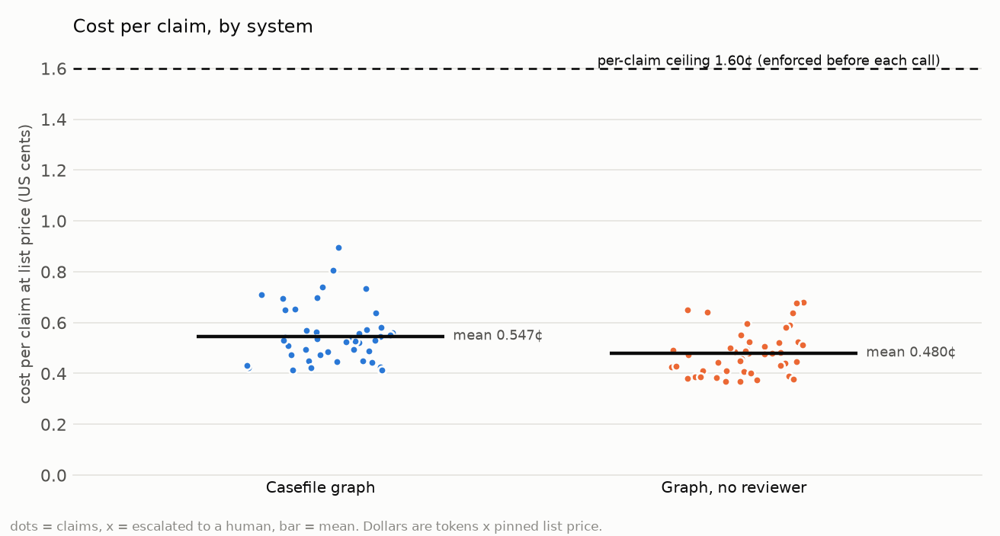

# Casefile results

Every number below is generated from `eval/results/<batch>.json` by `casefile results-md <batch>`. Decisions, payouts,
SIU flags and extracted fields are graded by code against ground truth computed by the claims-manual rules.
Cost is measured tokens x a pinned list price (`config/pricing.yaml`).

## Final development run (`dev-v2`, 45 claims)

| | Casefile graph | Graph, no reviewer |
|---|---|---|
| Claims scored | 45 | 45 |
| Decision accuracy | 100% | 96% |
| Macro-F1 (5 decisions) | 1.00 | 0.95 |
| Unsafe approvals (pays a claim it shouldn't) | 0 (0%) | 2 (8%) |
| Missed payments (holds a claim that should pay) | 0% | 0% |
| Exact payout, when both say pay | 100% | 100% |
| SIU-flag recall | 100% | 100% |
| Escalated to a human | 0% | 0% |
| Extraction accuracy (10 fields) | 100% | 100% |
| LLM calls per claim | 4.2 | 3.0 |
| Cost per claim at list price (mean / p95) | $0.0055 / $0.0074 | $0.0048 / $0.0065 |
| Runs with a reviewer send-back | 4 | 0 |
| Ceiling overruns | 0 | 0 |

Accuracy by scenario (correct / claims):

| Scenario | Casefile graph | Graph, no reviewer |
|---|---|---|
| S01 clean collision | 3/3 | 3/3 |
| S02 clean comprehensive | 3/3 | 3/3 |
| S03 below deductible | 3/3 | 3/3 |
| S04 no coverage for cause | 3/3 | 3/3 |
| S05 policy not in force | 3/3 | 3/3 |
| S06 inflated estimate | 3/3 | 3/3 |
| S07 comp-only policy | 3/3 | 3/3 |
| S08 total loss | 3/3 | 3/3 |
| S09 supplement estimate | 3/3 | 3/3 |
| S10 unrepaired prior damage | 3/3 | 3/3 |
| S11 damage mismatch | 3/3 | 3/3 |
| S12 date conflict | 3/3 | 3/3 |
| S13 unlisted driver | 3/3 | 3/3 |
| S14 missing document | 3/3 | 1/3 |
| S15 VIN typo | 3/3 | 3/3 |

## Held-out test claims (`test-v1`, 22 claims)

Claims the system never saw during development. Baseline systems (single prompt, single agent) are implemented and run
with `make test-eval`.

| | Casefile graph | Graph, no reviewer |
|---|---|---|
| Claims scored | 22 | 22 |
| Decision accuracy | 100% | 100% |
| Macro-F1 (5 decisions) | 1.00 | 1.00 |
| Unsafe approvals (pays a claim it shouldn't) | 0 (0%) | 0 (0%) |
| Missed payments (holds a claim that should pay) | 0% | 0% |
| Exact payout, when both say pay | 100% | 100% |
| SIU-flag recall | 100% | 100% |
| Escalated to a human | 0% | 0% |
| Extraction accuracy (10 fields) | 100% | 100% |
| LLM calls per claim | 4.0 | 3.0 |
| Cost per claim at list price (mean / p95) | $0.0052 / $0.0070 | $0.0047 / $0.0064 |
| Runs with a reviewer send-back | 0 | 0 |
| Ceiling overruns | 0 | 0 |

Accuracy by scenario (correct / claims):

| Scenario | Casefile graph | Graph, no reviewer |
|---|---|---|
| S01 clean collision | 1/1 | 1/1 |
| S02 clean comprehensive | 3/3 | 3/3 |
| S03 below deductible | 3/3 | 3/3 |
| S04 no coverage for cause | 1/1 | 1/1 |
| S05 policy not in force | 2/2 | 2/2 |
| S06 inflated estimate | – | – |
| S07 comp-only policy | 1/1 | 1/1 |
| S08 total loss | 2/2 | 2/2 |
| S09 supplement estimate | 3/3 | 3/3 |
| S10 unrepaired prior damage | 2/2 | 2/2 |
| S11 damage mismatch | 1/1 | 1/1 |
| S12 date conflict | 1/1 | 1/1 |
| S13 unlisted driver | 1/1 | 1/1 |
| S14 missing document | – | – |
| S15 VIN typo | 1/1 | 1/1 |

## First development run (`dev-v1`, 40 claims)

Kept as run, before the prompt and code fixes that `dev-v2` confirms.

| | Casefile graph | Graph, no reviewer |
|---|---|---|
| Claims scored | 40 | 40 |
| Decision accuracy | 95% | 80% |
| Macro-F1 (5 decisions) | 0.95 | 0.84 |
| Unsafe approvals (pays a claim it shouldn't) | 0 (0%) | 1 (5%) |
| Missed payments (holds a claim that should pay) | 6% | 28% |
| Exact payout, when both say pay | 100% | 100% |
| SIU-flag recall | 100% | 100% |
| Escalated to a human | 0% | 0% |
| Extraction accuracy (10 fields) | 100% | 100% |
| LLM calls per claim | 4.8 | 3.0 |
| Cost per claim at list price (mean / p95) | $0.0060 / $0.0101 | $0.0048 / $0.0065 |
| Runs with a reviewer send-back | 11 | 0 |
| Ceiling overruns | 0 | 0 |

Accuracy by scenario (correct / claims):

| Scenario | Casefile graph | Graph, no reviewer |
|---|---|---|
| S01 clean collision | 2/2 | 2/2 |
| S02 clean comprehensive | 2/2 | 1/2 |
| S03 below deductible | 3/3 | 3/3 |
| S04 no coverage for cause | 2/2 | 2/2 |
| S05 policy not in force | 3/3 | 2/3 |
| S06 inflated estimate | 3/3 | 3/3 |
| S07 comp-only policy | 2/2 | 2/2 |
| S08 total loss | 2/3 | 0/3 |
| S09 supplement estimate | 3/3 | 3/3 |
| S10 unrepaired prior damage | 3/3 | 3/3 |
| S11 damage mismatch | 3/3 | 3/3 |
| S12 date conflict | 2/2 | 2/2 |
| S13 unlisted driver | 2/3 | 2/3 |
| S14 missing document | 3/3 | 2/3 |
| S15 VIN typo | 3/3 | 2/3 |
